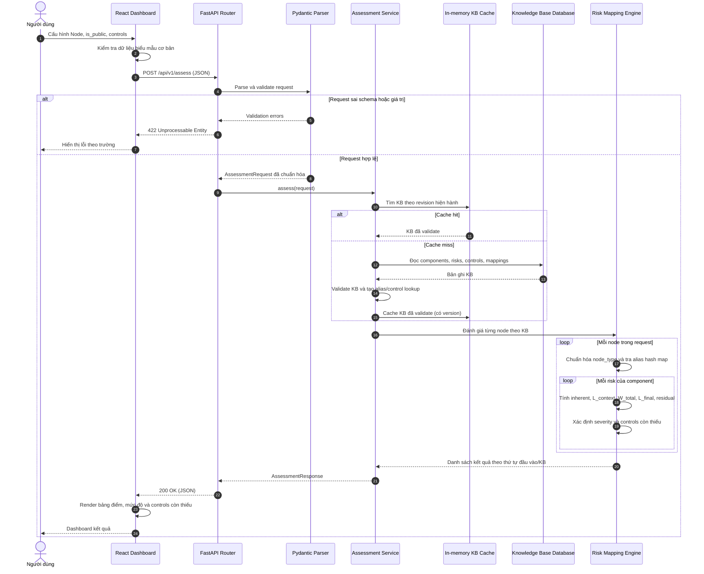
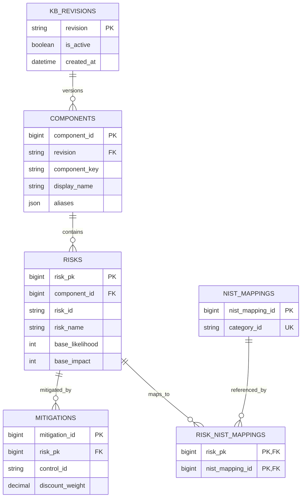

# Báo cáo kỹ thuật: Kiến trúc và động cơ đánh giá rủi ro an toàn AI

## Phạm vi và nguồn dữ liệu chuẩn

Tài liệu này đặc tả hệ thống theo đúng Knowledge Base (KB) và công thức được cung cấp trong yêu cầu. Vì vậy, báo cáo chỉ đánh giá các rủi ro và biện pháp giảm thiểu xuất hiện trong JSON đó; không tự đưa thêm điểm số, mã kiểm soát hoặc ngưỡng phân loại. KB hiện có trong `rule_store.json` của workspace chứa thêm rủi ro, metadata và mô tả biện pháp khác với tập JSON chuẩn của yêu cầu. Khi triển khai đặc tả này, cần đồng bộ KB trước khi dùng kết quả để đánh giá thật; không trộn hai phiên bản dữ liệu.

Các ngưỡng phân loại áp dụng: **Low 1–5**, **Medium 6–11**, **High 12–19**, **Critical 20–25**. Để đáp ứng response API mà không làm mất tín hiệu của risk nghiêm trọng nhất, `overall_risk_score` được định nghĩa bảo thủ là điểm residual lớn nhất trong các risk đã đánh giá; `overall_severity` là severity tương ứng. Đây không phải trung bình hoặc tổng điểm.

## Phần I — Nhiệm vụ tuần 2: Kiến trúc hệ thống và cơ sở dữ liệu

### 1. Sơ đồ luồng dữ liệu



Cache chỉ giữ KB đã được xác thực và gắn với một revision cụ thể. Khi KB đổi revision, ứng dụng phải thay cache một cách nguyên tử hoặc vô hiệu hóa cache; không phục vụ một assessment bằng dữ liệu trộn từ hai revision. Lỗi đọc DB/KB không được biến thành kết quả rỗng có vẻ thành công.

### 2. Thiết kế lược đồ lưu trữ

#### 2.1 MongoDB — Document-oriented

Một tài liệu cho mỗi component giúp truy xuất toàn bộ các risk, mitigations và NIST mappings của một node trong một lần đọc. Lưu metadata/version ở collection riêng để quản lý phát hành KB.

```json
{
  "_id": "Model",
  "component_key": "Model",
  "display_name": "Model",
  "aliases": ["model", "llm", "foundation model", "genai"],
  "risks": [
    {
      "risk_id": "LLM01",
      "risk_name": "Prompt Injection",
      "base_likelihood": 4,
      "base_impact": 4,
      "nist_mappings": ["MAP 5.1", "MEASURE 2.7"],
      "technical_mitigations": [
        {"control_id": "CTRL_SYS_PROMPT_SEP", "discount_weight": 0.25},
        {"control_id": "CTRL_GUARDRAILS", "discount_weight": 0.35}
      ]
    }
  ]
}
```

```json
{
  "_id": "kb_revision",
  "revision": "immutable-revision-id",
  "severity_thresholds": {
    "Low": {"min": 1, "max": 5},
    "Medium": {"min": 6, "max": 11},
    "High": {"min": 12, "max": 19},
    "Critical": {"min": 20, "max": 25}
  },
  "status": "active"
}
```

`immutable-revision-id` là định danh phát hành do hệ thống quản trị KB cấp, không phải giá trị điểm số mới. Với hệ thống chỉ lưu đúng bản dữ liệu người dùng đưa ra, có thể ghi bản revision đó như một snapshot bất biến; không suy diễn phiên bản cụ thể từ nội dung JSON.

**Index đề xuất**

| Collection | Index | Mục đích |
|---|---|---|
| `components` | Unique `{ component_key: 1 }` | Ngăn trùng khóa component chuẩn |
| `components` | `{ aliases: 1 }` | Tìm component theo alias; đây là multikey index |
| `components` | `{ "risks.risk_id": 1 }` | Tra cứu risk để điều tra/báo cáo; `risk_id` không unique toàn cục vì LLM03 xuất hiện ở nhiều component |
| `components` | `{ component_key: 1, "risks.risk_id": 1 }` | Tra risk trong phạm vi một component |
| `components` | `{ "risks.technical_mitigations.control_id": 1 }` | Tìm các risk bị ảnh hưởng khi tra cứu control |
| `kb_revisions` | Unique `{ revision: 1 }`; partial unique `{ status: 1 }` cho `status: "active"` | Định danh revision và bảo đảm tối đa một KB active |

MongoDB không bảo đảm uniqueness của từng `risk_id` nằm lặp trong cùng một document chỉ nhờ unique multikey index. Nếu cần ràng buộc duy nhất `(component_key, risk_id)` ở mức cơ sở dữ liệu, nên tách risks thành collection riêng hoặc kiểm tra tính duy nhất khi phát hành KB. Dùng schema validation để giới hạn likelihood/impact trong 1–5, discount trong 0–1, và kiểm tra cấu trúc bắt buộc. Không index các điểm residual tính theo request: đó là dữ liệu dẫn xuất, phụ thuộc `is_public` và controls của từng assessment.

#### 2.2 PostgreSQL/MySQL — lược đồ quan hệ chuẩn hóa



Các khóa và ràng buộc chính:

- `COMPONENTS.component_id`, `RISKS.risk_pk`, `MITIGATIONS.mitigation_id`, `NIST_MAPPINGS.nist_mapping_id` là khóa chính.
- `RISKS.component_id` tham chiếu `COMPONENTS`; `MITIGATIONS.risk_pk` tham chiếu `RISKS`; bảng nối `RISK_NIST_MAPPINGS` có khóa chính kép và hai khóa ngoại.
- Đặt unique `(revision, component_key)` cho `COMPONENTS` và `(component_id, risk_id)` cho `RISKS`. Không đặt unique toàn cục trên `risk_id`, vì một mã có thể được dùng ở nhiều component.
- Dùng `CHECK (base_likelihood BETWEEN 1 AND 5)`, `CHECK (base_impact BETWEEN 1 AND 5)` và `CHECK (discount_weight BETWEEN 0 AND 1)`. Nếu cần đảm bảo tổng discount trần 0.80, thực hiện trong engine; constraint hàng đơn không đủ để giới hạn tổng trên nhiều mitigation.
- Lưu aliases dạng JSON/JSONB là lựa chọn đơn giản cho danh sách nhỏ và chủ yếu đọc theo component. Nếu cần tra alias thường xuyên hoặc ràng buộc không trùng sau chuẩn hóa, tách thành `COMPONENT_ALIASES(alias_normalized PK, component_id FK)`.
- Tách bảng `KB_REVISIONS` để phát hành KB bất biến, hỗ trợ rollback/audit và cache theo revision; chỉ chuyển `is_active` sau khi toàn bộ dữ liệu revision mới đã validate.

### 3. Đặc tả API — OpenAPI 3.0

Request nhận một hoặc nhiều node. `node_type` trong contract này phải là tên component chuẩn trong KB; engine vẫn tạo alias map để hỗ trợ các luồng tích hợp cho phép alias ở phiên bản API khác. Controls không nằm trong mitigation của risk đang xét không tạo ra discount. Controls trùng lặp không được cộng trọng số lặp lại.

```yaml
openapi: 3.0.3
info:
  title: AI System Risk Assessment API
  version: 1.0.0
  description: Deterministic assessment using the configured risk knowledge base.
servers:
  - url: /api/v1
paths:
  /assess:
    post:
      operationId: assessArchitecture
      summary: Assess risks for an AI system architecture
      requestBody:
        required: true
        content:
          application/json:
            schema:
              $ref: "#/components/schemas/AssessmentRequest"
            example:
              architecture:
                - node_type: Model
                  is_public: true
                  controls: [CTRL_SYS_PROMPT_SEP]
                - node_type: Vector DB
                  is_public: false
                  controls: []
      responses:
        "200":
          description: Risk results, one item per matching node-risk pair.
          content:
            application/json:
              schema:
                $ref: "#/components/schemas/AssessmentResponse"
        "422":
          description: Request schema or field validation failed.
          content:
            application/json:
              schema:
                $ref: "#/components/schemas/ValidationError"
        "503":
          description: The validated knowledge base is unavailable.
          content:
            application/json:
              schema:
                $ref: "#/components/schemas/ServiceError"
components:
  schemas:
    AssessmentRequest:
      type: object
      additionalProperties: false
      required: [architecture]
      properties:
        architecture:
          type: array
          minItems: 1
          items:
            $ref: "#/components/schemas/ArchitectureNode"
    ArchitectureNode:
      type: object
      additionalProperties: false
      required: [node_type, is_public]
      properties:
        node_type:
          type: string
          minLength: 1
          description: Canonical component key or alias recognized by the active knowledge base.
        is_public:
          type: boolean
          description: Whether the component is exposed to a public network.
        controls:
          type: array
          items:
            type: string
            minLength: 1
          description: Applied control identifiers; values are trimmed, uppercased, and deduplicated.
    AssessmentResponse:
      type: object
      additionalProperties: false
      required: [results, overall_risk_score, overall_severity, risk_matrix_summary]
      properties:
        results:
          type: array
          items:
            $ref: "#/components/schemas/RiskResult"
        overall_risk_score:
          type: integer
          minimum: 1
          maximum: 25
          description: Highest residual risk score across evaluated risks.
        overall_severity:
          type: string
          enum: [Low, Medium, High, Critical]
        risk_matrix_summary:
          type: array
          minItems: 5
          maxItems: 5
          description: Rows are likelihood 1–5; columns are impact 1–5.
          items:
            type: array
            minItems: 5
            maxItems: 5
            items:
              type: integer
              minimum: 0
    RiskResult:
      type: object
      additionalProperties: false
      required:
        - source_component
        - risk_id
        - risk_name
        - nist_categories
        - attack_scenario
        - inherent_score
        - residual_likelihood
        - residual_impact
        - residual_score
        - severity_level
        - recommended_action
        - missing_mitigations
      properties:
        source_component:
          type: string
        risk_id:
          type: string
        risk_name:
          type: string
        nist_categories:
          type: array
          items:
            type: string
        attack_scenario:
          type: string
        inherent_score:
          type: integer
          minimum: 1
          maximum: 25
        residual_likelihood:
          type: integer
          minimum: 1
          maximum: 5
        residual_impact:
          type: integer
          minimum: 1
          maximum: 5
        residual_score:
          type: integer
          minimum: 1
          maximum: 25
        severity_level:
          type: string
          enum: [Low, Medium, High, Critical]
        recommended_action:
          type: string
        missing_mitigations:
          type: array
          items:
            type: string
    ValidationError:
      type: object
      required: [detail]
      properties:
        detail:
          type: array
          items:
            type: object
            required: [loc, msg, type]
            properties:
              loc:
                type: array
                items:
                  oneOf:
                    - type: string
                    - type: integer
              msg:
                type: string
              type:
                type: string
    ServiceError:
      type: object
      required: [detail]
      properties:
        detail:
          type: string
```

Node không nằm trong KB hoặc control không thuộc component được chọn phải được báo lỗi rõ ràng (422), không được âm thầm bỏ qua. Ma trận 5×5 đếm từng risk theo likelihood residual và impact gốc; response lưu các hàng theo likelihood 1–5 và cột theo impact 1–5.

## Phần II — Nhiệm vụ tuần 3: Thuật toán và kiểm thử

### 1. Mô hình toán học và pseudocode

Với mỗi risk, đặt `L_base` và `I_base` theo KB. Điểm tiềm tàng là `S_base = L_base × I_base`. Tính `L_context = L_base` nếu public, ngược lại `max(1, L_base − 1)`. Tổng discount là tổng trọng số của mitigation áp dụng cho risk đó, giới hạn trên ở 0.80. Sau đó `L_final = max(1, round(L_context × (1 − W_total)))`, `S_residual = L_final × I_base`. Severity được tra theo đúng khoảng ngưỡng của KB.

```text
FUNCTION assess(request, knowledge_base):
    REQUIRE request.nodes is not empty
    REQUIRE knowledge_base has passed schema and consistency validation

    alias_to_component := empty hash map
    FOR EACH component_key, component IN knowledge_base.components:
        alias_to_component[normalize(component_key)] := component_key
        FOR EACH alias IN component.aliases:
            normalized_alias := normalize(alias)
            IF normalized_alias maps to a different component_key:
                RAISE KnowledgeBaseAliasConflict
            alias_to_component[normalized_alias] := component_key

    results := empty list
    FOR EACH node IN request.nodes, preserving request order:
        normalized_type := normalize(node.node_type)
        IF normalized_type NOT IN alias_to_component:
            RAISE UnknownComponentError(node.node_type)

        component_key := alias_to_component[normalized_type]
        component := knowledge_base.components[component_key]
        active_controls := SET(normalize_control(c) FOR c IN node.controls)

        FOR EACH risk IN component.risks, preserving KB order:
            L_base := risk.base_likelihood
            I_base := risk.base_impact
            inherent_score := L_base * I_base

            applicable_controls := SET(
                normalize_control(m.control_id)
                FOR m IN risk.technical_mitigations
            )
            applied := active_controls INTERSECTION applicable_controls
            W_sum := SUM(m.discount_weight FOR m IN risk.technical_mitigations
                         IF normalize_control(m.control_id) IN applied)
            W_total := MIN(0.80, W_sum)

            IF node.is_public:
                L_context := L_base
            ELSE:
                L_context := MAX(1, L_base - 1)

            L_final := MAX(1, ROUND_AS_DEFINED(L_context * (1 - W_total)))
            residual_score := L_final * I_base
            severity := lookup_severity(residual_score, knowledge_base.severity_thresholds)
            missing := applicable_controls - active_controls

            APPEND one RiskResult to results with:
                canonical component_key, risk identifiers and NIST IDs,
                L_base, I_base, inherent_score, L_context, W_total,
                L_final, residual impact I_base, residual_score, severity,
                applied control IDs and missing control IDs

    RETURN results

FUNCTION normalize(value):
    RETURN lowercase(trim(value))

FUNCTION normalize_control(value):
    RETURN uppercase(trim(value))

FUNCTION lookup_severity(score, thresholds):
    FOR EACH level, range IN thresholds:
        IF range.min <= score <= range.max:
            RETURN level
    RAISE KnowledgeBaseThresholdGapError(score)
```

Đầu vào được kiểm tra trước khi engine chạy: `node_type` phải tồn tại, `is_public` phải là boolean, `controls` là danh sách chuỗi không rỗng từng phần tử, và không được phép có thuộc tính không xác định nếu API dùng `extra="forbid"`. Alias tra cứu không phân biệt hoa/thường và bỏ khoảng trắng ở hai đầu; xung đột alias là lỗi cấu hình KB. Controls không liên quan đến risk không được cộng discount. Deduplicate controls để một mã lặp trong request không nhân đôi trọng số.

`ROUND_AS_DEFINED` phải có cùng quy tắc giữa các runtime. Công thức chỉ ghi `round` và không quy định cách xử lý chính xác trường hợp .5; Python dùng bankers’ rounding cho các trường hợp hòa, có thể khác một số ngôn ngữ. Vì vậy, quy tắc làm tròn cần được chốt trong đặc tả triển khai và kiểm thử liên ngôn ngữ. Các ca dưới đây không rơi vào trường hợp hòa nên không bị ảnh hưởng.

### 2. Kịch bản kiểm thử tính toán

#### Kịch bản A — RAG GenAI thiếu phòng vệ

**Node Model** (`is_public=true`, controls `CTRL_SYS_PROMPT_SEP`)

1. **LLM01 — Prompt Injection:** `L_base=4`, `I_base=4`, nên `S_base=4×4=16`. Public nên `L_context=4`. Chỉ `CTRL_SYS_PROMPT_SEP` áp dụng: `W_total=min(0.80, 0.25)=0.25`. `L_final=max(1, round(4×(1−0.25)))=round(3)=3`. `S_residual=3×4=12`, severity **High**. Thiếu `CTRL_GUARDRAILS`.
2. **LLM06 — Sensitive Information Disclosure:** `L_base=3`, `I_base=4`, nên `S_base=3×4=12`. Public nên `L_context=3`. Không có `CTRL_PII_MASKING`: `W_total=0`. `L_final=max(1, round(3×1))=3`. `S_residual=3×4=12`, severity **High**. Thiếu `CTRL_PII_MASKING`.

**Node Vector DB** (`is_public=false`, controls rỗng)

3. **LLM03 — Training / RAG Data Poisoning:** `L_base=3`, `I_base=5`, nên `S_base=3×5=15`. Internal nên `L_context=max(1, 3−1)=2`. Không có controls áp dụng: `W_total=0`. `L_final=max(1, round(2×1))=2`. `S_residual=2×5=10`, severity **Medium**. Thiếu `CTRL_VECTOR_RBAC` và `CTRL_RAG_VALIDATION`.

Kết quả JSON (các trường và giá trị lấy từ KB chuẩn; không tạo điểm tổng hợp):

```json
{
  "results": [
    {
      "node_type": "Model",
      "risk_id": "LLM01",
      "risk_name": "Prompt Injection",
      "nist_mappings": ["MAP 5.1", "MEASURE 2.7"],
      "base_likelihood": 4,
      "base_impact": 4,
      "inherent_score": 16,
      "context_likelihood": 4,
      "total_discount": 0.25,
      "residual_likelihood": 3,
      "residual_impact": 4,
      "residual_score": 12,
      "severity": "High",
      "applied_controls": ["CTRL_SYS_PROMPT_SEP"],
      "missing_controls": ["CTRL_GUARDRAILS"]
    },
    {
      "node_type": "Model",
      "risk_id": "LLM06",
      "risk_name": "Sensitive Information Disclosure",
      "nist_mappings": ["MEASURE 2.10"],
      "base_likelihood": 3,
      "base_impact": 4,
      "inherent_score": 12,
      "context_likelihood": 3,
      "total_discount": 0.0,
      "residual_likelihood": 3,
      "residual_impact": 4,
      "residual_score": 12,
      "severity": "High",
      "applied_controls": [],
      "missing_controls": ["CTRL_PII_MASKING"]
    },
    {
      "node_type": "Vector DB",
      "risk_id": "LLM03",
      "risk_name": "Training / RAG Data Poisoning",
      "nist_mappings": ["MAP 4.1", "MEASURE 2.6"],
      "base_likelihood": 3,
      "base_impact": 5,
      "inherent_score": 15,
      "context_likelihood": 2,
      "total_discount": 0.0,
      "residual_likelihood": 2,
      "residual_impact": 5,
      "residual_score": 10,
      "severity": "Medium",
      "applied_controls": [],
      "missing_controls": ["CTRL_VECTOR_RBAC", "CTRL_RAG_VALIDATION"]
    }
  ]
}
```

#### Kịch bản B — Hệ thống học máy truyền thống đã tối ưu bảo mật

**Node Predictive Model** (`is_public=true`, controls `CTRL_ADVERSARIAL_TRAIN`, `CTRL_INPUT_DENOISING`)

1. **ML01 — Adversarial Attack (Evasion):** `L_base=4`, `I_base=4`, nên `S_base=4×4=16`. Public nên `L_context=4`. `W_total=min(0.80, 0.35+0.25)=0.60`. `L_final=max(1, round(4×(1−0.60)))=round(1.6)=2`. `S_residual=2×4=8`, severity **Medium**. Không thiếu mitigation nào của risk này.

**Node API Gateway** (`is_public=true`, control `CTRL_RATE_LIMITING`)

2. **LLM04 — Model Denial of Service (DoS):** `L_base=5`, `I_base=3`, nên `S_base=5×3=15`. Public nên `L_context=5`. `W_total=min(0.80, 0.45)=0.45`. `L_final=max(1, round(5×(1−0.45)))=round(2.75)=3`. `S_residual=3×3=9`, severity **Medium**. Không thiếu mitigation nào của risk này.

Kết quả JSON:

```json
{
  "results": [
    {
      "node_type": "Predictive Model",
      "risk_id": "ML01",
      "risk_name": "Adversarial Attack (Evasion)",
      "nist_mappings": ["MEASURE 2.7"],
      "base_likelihood": 4,
      "base_impact": 4,
      "inherent_score": 16,
      "context_likelihood": 4,
      "total_discount": 0.6,
      "residual_likelihood": 2,
      "residual_impact": 4,
      "residual_score": 8,
      "severity": "Medium",
      "applied_controls": ["CTRL_ADVERSARIAL_TRAIN", "CTRL_INPUT_DENOISING"],
      "missing_controls": []
    },
    {
      "node_type": "API Gateway",
      "risk_id": "LLM04",
      "risk_name": "Model Denial of Service (DoS)",
      "nist_mappings": ["MANAGE 1.3"],
      "base_likelihood": 5,
      "base_impact": 3,
      "inherent_score": 15,
      "context_likelihood": 5,
      "total_discount": 0.45,
      "residual_likelihood": 3,
      "residual_impact": 3,
      "residual_score": 9,
      "severity": "Medium",
      "applied_controls": ["CTRL_RATE_LIMITING"],
      "missing_controls": []
    }
  ]
}
```

### 3. Biện luận kỹ thuật học thuật (khoảng 300–400 từ)

Đối với công cụ lượng hóa rủi ro an toàn AI, **deterministic rule-based engine kết hợp Pydantic validation** phù hợp hơn việc giao phép đánh giá cho một LLM sinh văn bản. Tính tất định bảo đảm cùng kiến trúc đầu vào và cùng revision Knowledge Base tạo ra cùng điểm số, severity và danh sách controls còn thiếu. Vì công thức là phép biến đổi số học xác định, engine có thể được kiểm thử theo từng bước và tái lập kết quả. Kết quả không dao động theo sampling, cách viết prompt, phiên bản mô hình hay trạng thái của một dịch vụ bên ngoài.

LLM có thể tạo nội dung hợp lý nhưng không có trong KB, nhầm mã control, tự đặt trọng số hoặc hiểu sai tác động của `is_public`. Hallucination như vậy nguy hiểm nếu báo cáo được dùng cho quyết định triển khai, ưu tiên khắc phục hoặc tuân thủ. Pydantic kiểm tra kiểu, trường bắt buộc, cấu trúc và miền giá trị trước khi tính; engine chỉ dùng risk, threshold và discount đã được phê duyệt. Validation không chứng minh tính đúng nghiệp vụ của KB, nhưng phân biệt rõ request sai cấu trúc với kết quả hợp lệ và ngăn dữ liệu sai định dạng đi vào phép tính.

Về kiểm toán, mỗi kết quả có thể truy ngược tới request, revision KB, công thức, từng control và các giá trị trung gian như `L_context`/`W_total`. Lưu các dữ liệu này cùng thời điểm đánh giá giúp tái dựng quyết định và giải thích cách nhận diện, đo lường, xử lý rủi ro theo quy trình quản trị gắn với NIST AI RMF; một đoạn văn do LLM sinh khó bảo đảm mức truy nguyên tương đương. Engine chạy nội bộ nên có độ trễ thấp, chi phí biên ổn định và không phụ thuộc kết nối, giới hạn tốc độ, giá token hoặc thay đổi chính sách API bên ngoài. LLM vẫn có thể hỗ trợ diễn đạt báo cáo, nhưng chỉ ở lớp trình bày sau khi kết quả có cấu trúc đã được tính; không được sửa điểm, severity hay dẫn chứng. Phân tách này giữ lõi quyết định có thể kiểm chứng mà vẫn cho phép giao diện giải thích dễ đọc.
